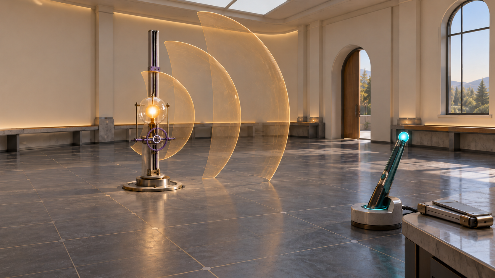
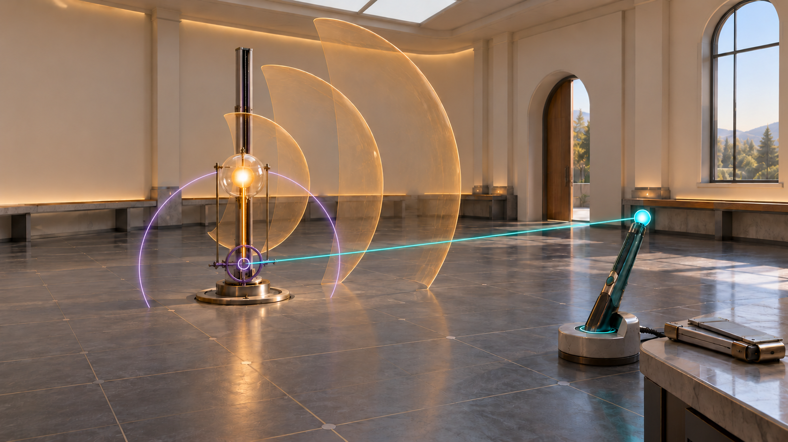
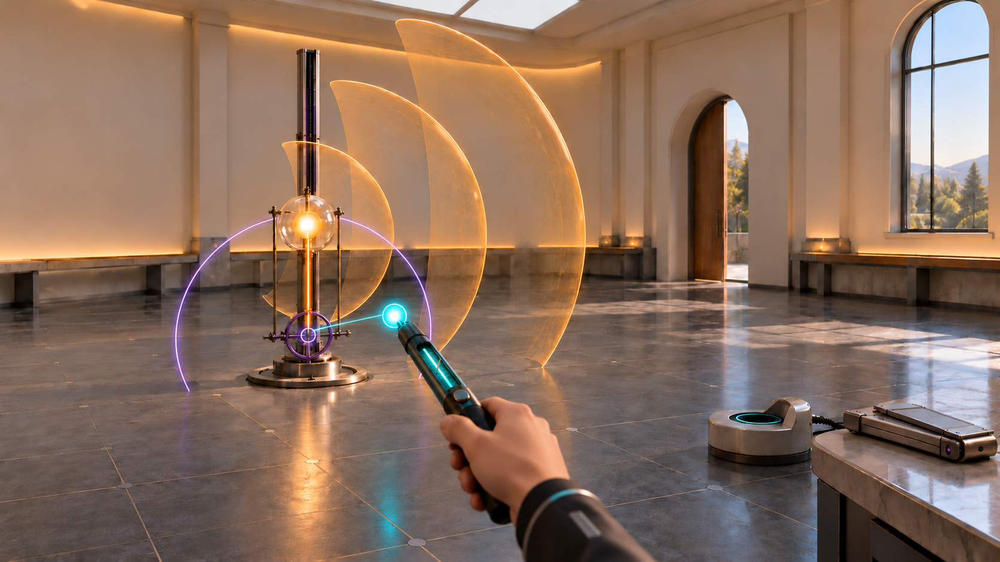

# Lesson 14 Experiment 1 — Walkable Potential Atlas

Three-view design storyboard for review. **This is concept art and an instructional specification, not an implemented scene.** The images establish composition and material language. Production equipotentials and the convergence boundary must be generated from the physics, not traced from the illustrations.

## Visual and mathematical rules shared by all views

- **Amber is physical:** one fixed positive point charge in a glass and ceramic mount. Three sparse, partial *spherical equipotential surfaces* are centered on that charge. They are level sets of the exact point-charge potential, not radiation, field lines, or additional sources. Their geometry and world position do not change when the coordinate origin moves.
- **Violet is a coordinate choice:** a graspable ring carriage travels only along the source's vertical polar axis. Its own geometry is visibly different from the source mount. The violet convergence boundary is a sparse meridian of a sphere centered on this ring, with radius $R_{\max}=|\mathbf r'|$ for the one point charge. It is a mathematical domain marker, not a physical shell. It appears while the coordinate instrument is selected or the boundary is under investigation.
- **Teal is observation:** the student can lift a sensing wand by near or ray grab. The glowing tip is the observation point. A short active strip on its handle reports the *exact* local potential. The exact reading changes when the tip moves relative to the charge; shifting only the origin does not change it.
- **A secondary calculation instrument** sits by the probe dock. Outside the boundary, it can expose signed potential contributions $V_0,V_1,\ldots$ on one volts scale and their truncated sum beside the independent exact reading. At and inside $r=R_{\max}$, it closes the exterior result rather than displaying zero or claiming that the exact potential is undefined.
- Source, origin, probe, equipotential contours, and convergence boundary have distinct silhouettes and materials as well as colors. No dense wireframes, full opaque domes, field-arrow lattices, walls of text, or mandatory interaction gates.

The room is approximately **7 m × 7 m** with a level floor. The source center is about **1.50 m** high in a fixed mount; its luminous core is only about **8 cm** across. The origin ring is about **22 cm** across on a rail aligned with that source, with its useful grab range kept near waist and chest height. The handheld probe is about **45 cm** long with a **6 cm** sensing tip, docked about **2.4 m** to the right of the source. Amber contour patches correspond to approximately **0.9, 1.6, and 2.3 m** source radii. Their opacity should be low enough that the source, the student's hand, and walking path remain visible. Lighting is soft daylight with controlled local highlights, not a dark spectacle.

## View 1 — Entering the laboratory

**Camera and layout.** Standing eye height is roughly **1.6 m**, about **2.8 m** from the source at entry. From the doorway side, the fixed source occupies the left third of a wide view, the probe dock the right third, and the center remains open for walking. The violet origin ring is parked below the charge on the **same vertical axis**, visually separate from the amber core. The largest contour patch reaches into the room without closing it off.

**What the student does.** They can approach either object immediately, lift the probe, walk between the contour patches, or grab the origin carriage. A guided suggestion may invite them to align the ring with the charge first; it is not a lock or a required task. At that alignment, the source distance is zero. Free Exploration shows the same objects without the suggestion.

**Discovery.** Source-centered potential contours and the probe's exact reading respond to the probe's physical position. The coordinate ring is an instrument used to describe those positions. It is not a second source of potential. The centered point-charge case from Workbook Activity 2 becomes a place the student can establish physically.

**Annotation timing.** Entry has no equations or world-sized labels. A small cue on the student's peripheral instrument can identify the fixed source, movable origin, and probe by form and color. After the student aligns the ring with the charge and inspects it, a compact local note may reveal $r'=0$, $Q_0=q$, and $Q_{n\ge1}=0$. The detailed reason the undefined source angle causes no problem belongs in the workbook/key, available as an optional deeper explanation.

**Unobstructed:** the source core, ring grab surface, probe handle and tip, open route between the apparatus and dock, and the Quest exit/recenter affordances. Contour patches must fade or clip where they would sit in front of a hand or hide the source.

## View 2 — Moving the coordinate origin

**Camera and layout.** Keep almost the **same eye-level viewpoint and screen positions** as View 1 so stillness is evident. The student has slid the violet ring downward on its central rail to about **0.90 m** high, within comfortable reach. The source remains near **1.50 m**; the probe remains docked. In this illustrative pose, $R_{\max}$ is about **0.60 m**. The amber contour patches and room lighting are identical to View 1.

**What the student does.** They optionally record a prediction, hold or ray grab the ring, and slide it while leaving the probe docked. Two slender temporary rays extend from the ring: amber to the fixed source and teal to the fixed probe tip. The sparse violet meridian changes radius with the amber ray and touches the source. Releasing the ring removes the rays after a brief comparison interval; the boundary can remain visible while studying convergence.

**Discovery.** The physical distance from charge to probe, exact potential, and amber contour geometry stay fixed. The source and observation **coordinate vectors**, higher moments, and exterior boundary change because their common starting point moved. The violet arc and amber contour patches must never share a texture or animation, since they mean different things.

**Annotation timing.** While the rays are selected, short markings at the instrument identify $\mathbf r'$ and $\mathbf r$, with the lesson's polar $\theta$ measured from $+z$. Only after the origin shift does a small local strip offer $Q_n=q(z')^n$. The optional calculation instrument may then open to show signed $V_n$ contributions in **volts** and their sum. It must preserve a separate exact reference and must not compare $Q_n$ values with different units on one visual scale.

**Unobstructed:** the ring and rail grasp point, fixed source, docked probe tip, both ray endpoints, and the gap between the violet boundary and the nearest amber contour. Rays are thin and visible only when useful; no plane or panel may cover the charge.

## View 3 — Crossing the convergence boundary

**Camera and layout.** From nearly the same room side, the student's hand and wand enter the lower foreground at normal arm's reach. The amber charge remains left of center. The fixed amber contours and displaced violet boundary retain their View 2 positions. The teal tip is about **0.45 m** laterally from the origin and slightly above it: visibly inside a roughly **0.60 m** boundary, while safely clear of the point charge.

**What the student does.** They lift the probe from its dock and move the *tip*, not their whole headset, from outside to inside the violet limit. The teal origin-to-observation ray follows the tip. They can reverse direction without resetting the environment. Guided mode may invite a prediction before the crossing; Free Exploration allows the same motion without prompts.

**Discovery.** The teal exact-measurement strip remains active and its reading generally changes because the probe moved. The small calculation instrument closes its **exterior approximation** at and inside the boundary; it does not report a zero potential. Moving back outside permits the student to compare the truncated result with the exact reading again. The violet limit is a convergence condition, not a physical wall and not an equipotential contour.

**Annotation timing.** The first crossing can place a small $r>R_{\max}$ mark at the violet threshold and a brief *exterior series not guaranteed here* cue at the closed instrument. If inspected, the exact probe can show $V_{\mathrm{exact}}=kq/|\mathbf r-\mathbf r'|$. Outside, opening the secondary instrument can reveal $V_n=kQ_nP_n(\cos\theta)/r^{n+1}$ and the chosen truncation order. The full derivation stays in the lesson materials.

**Unobstructed:** the student's hand and probe tip, the tip's position relative to the violet arc, the active teal exact strip, the closed approximation indicator, and the fixed amber source. Contour patches remain low-opacity and never mask the boundary crossing.

## Review checks before implementation

1. From the entry pose, can a new student identify **one physical source, one coordinate choice, and one observation tool** without reading a panel?
2. In Views 1 and 2, do the amber source and contours remain unmistakably fixed while only the violet coordinate geometry changes?
3. Can a student tell an **exact equipotential** from the **origin-centered convergence boundary** by both shape and material, including without color alone?
4. In View 3, is it clear that the exact reading is still active and that only the *exterior approximation* is withheld?
5. At standing and seated Quest eye heights, can the student grab the ring and probe, see both ray endpoints, and reach recenter/Exit VR without contour surfaces crossing the hand or view?

### Questions the still frames cannot settle

- The amber surfaces must read as **stationary equipotential level sets**, not emitted waves. They should never pulse or travel outward. Their production geometry must be true partial spheres centered on the source.
- The concept renders use a reflective floor. A production floor should be more matte so mirrored amber and violet arcs cannot be mistaken for additional physical or mathematical surfaces.
- The compact calculation instrument is intentionally minor in View 3. Its closed state may be too subtle at headset distance. Before implementation, validate a physical scale mock of the shutter and the probe's active exact strip from normal arm's reach.
- A side view could place the coordinate ring in front of the source mount. Check ring/source identity and grasp clearance from several head positions, including seated height, before finalizing the apparatus geometry.
- The visual boundary must follow the exact source distance from the selected origin. The painted meridian in the illustration is a composition cue, not a numerical geometry reference.

## Lesson sources and technical boundary

The [Lecture Review Guide](../../references/Lesson_14/PHY311_Lesson_14_Multipole_Expansion_Examples.pdf) gives the source/observation diagram, six-step procedure, and exterior domain. The [Student Workbook](../../references/Lesson_14/PHY311_Lesson_14_Multipole_Expansion_Examples_Student_Workbook.pdf) Activities 1–2 asks students to identify $r,r',dQ,Q_n,R_{\max}$ and explain the point charge at the origin. The [Worked Answer Key](../../references/Lesson_14/PHY311_Lesson_14_Multipole_Expansion_Examples_Worked_Answer_Key.pdf) establishes $Q_0=q$, vanishing higher centered moments, origin dependence, and $r>R_{\max}$. The [existing interactive HTML lab](../../references/Lesson_14/PHY311_Lesson_14_Multipole_Expansion_Examples_Interactive_Lab.html) motivates the exact-versus-truncated comparison.

The current numerical engine, tests, WebXR player rig, locomotion, and grabbing systems remain the foundation. The storyboard specifies a new presentation and interaction design only. The axial point-charge formula assumes the origin stays on the source's polar axis; the movable ring must respect that until a more general multipole model exists. No application code or deployment is part of this storyboard.

## Concept-image generation record

The three PNGs were made with the **built-in imagegen tool** for design review. The prompt set was:

1. **Entry:** a wide, eye-height 7 m laboratory with one mounted amber point charge; three sparse amber partial equipotential surfaces centered on it; a teal sensing wand in a dock; and a violet origin ring on a vertical rail. A targeted correction moved the rail onto the charge's polar axis while keeping the physical source, contours, and probe fixed.
2. **Origin shift:** edit the entry view without moving the amber source, amber contours, or teal probe; lower only the violet ring on its shared rail and add temporary origin-to-source and origin-to-probe rays plus one distinct violet convergence meridian centered on O.
3. **Boundary crossing:** retain the View 2 source, contours, origin, and boundary; move the handheld teal tip inside the violet limit, leave its small exact-measurement strip active, and show the secondary exterior calculation instrument closed.

All prompts excluded large dashboards, dense wireframes, extra charges, lightning effects, and numerical wall labels. The illustrations are not evidence that the equipotential and convergence surfaces have been rendered with exact numerical geometry.
